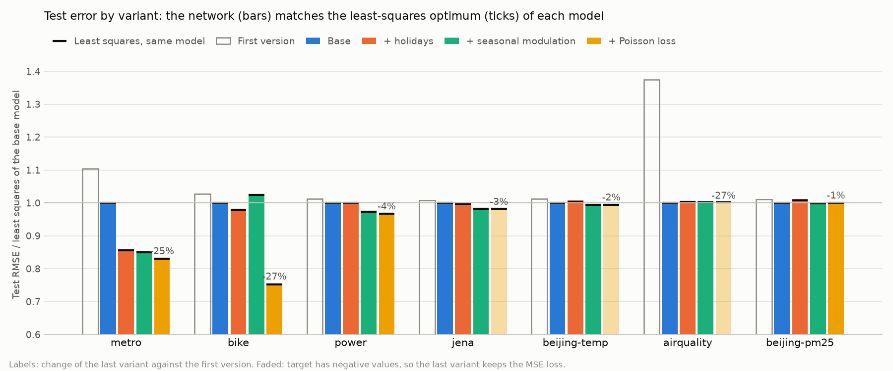
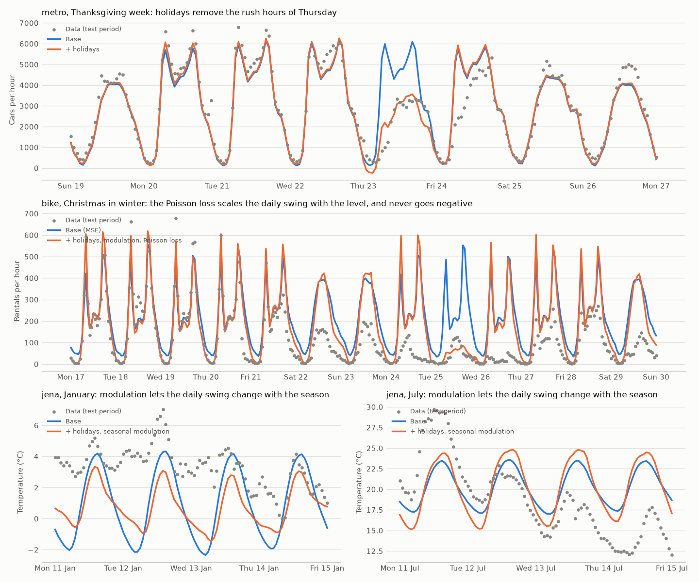
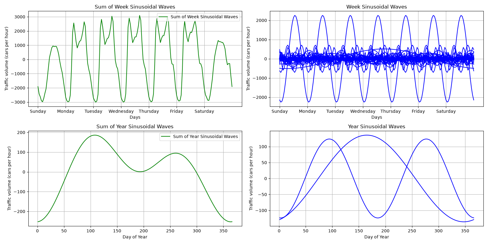

# siNetwork

Fits a time series as a learned sum of sinusoids over periodic components (day, week, year, ...) plus a linear trend:

    y(t) = offset + slope·t/span + Σ_components Σ_k α_k·sin(ω_k·t) + β_k·cos(ω_k·t)

`t` is time in days. A component with period P and n sinusoids has its frequencies fixed at the harmonics ω_k = 2πk/P (k = 1..n). The coefficients α and β, offset and slope are output by an MLP fed a constant input. Options add holiday effects, let the weekly shape change over the year, or make the components multiply instead of add (see [Usage](#usage)); [Results](#results) compares them.

Each sinusoid has two coefficients (equivalently an amplitude and a phase), so n sinusoids give a component 2n free numbers: it can follow a shape with about one value per P/2n. The default, `week:84 year:2`, is:

- `week:84`: 168 numbers for the 168 hours of a week, so any hourly weekly profile (Monday mornings can differ from Sunday mornings). The daily cycle is included, since the 7th weekly harmonic is one cycle per day.
- `year:2`: 4 numbers, about one per 3 months: a smooth seasonal swing. More yearly detail (`year:6` for monthly) needs several years of training data; with `airquality`'s single year it extrapolates wildly.

## Results

Test RMSE on the last 20% of each series, in the target's units (lower is better). Each column adds one option to the previous one:

| Dataset | First version | Least squares (base) | Base | + holidays | + seasonal modulation | + Poisson loss |
|---|---|---|---|---|---|---|
| `metro` | 519.8 | 470.6 | 471.2 | 402.9 | 401.2 | **391.4** |
| `bike` | 120.2 | 117.1 | 117.0 | 114.6 | 119.8 | **88.3** |
| `power` | 0.645 | 0.637 | 0.637 | 0.637 | 0.621 | **0.617** |
| `jena` | 4.510 | 4.473 | 4.472 | 4.461 | **4.391** | **4.391¹** |
| `beijing-temp` | 3.770 | 3.723 | 3.719 | 3.752 | **3.703** | **3.703¹** |
| `airquality` | 7.520 | 5.473 | **5.469** | 5.490 | 5.475 | 5.475¹ |
| `beijing-pm25` | 93.3 | 92.4 | 92.4 | 93.1 | **92.3** | 92.4 |

¹ Temperatures go below zero, which the Poisson loss can't model, so they keep the MSE loss: same value as the previous column.

- **First version**: the network as first written, which also learned a small deviation of each frequency from its harmonic, used amplitude and phase, and trained in batches of 256 (commit `b6f01c0`). The deviations let close sinusoids beat and copy one-off patterns of the training years, which then drift away on the test years.
- **Base**: `uv run train` with the defaults, frequencies fixed at the harmonics.
- **+ holidays** `--holidays`, **+ seasonal modulation** `--modulate 1`, **+ Poisson loss** `--loss poisson`: see [Usage](#usage).
- **Least squares**: every variant is linear in the numbers the MLP outputs (or, with the Poisson loss, its logarithm is), so its exact optimum can be computed directly. `train` fits it after training as a reference. Bars are the network, black ticks the least-squares fit of the same model:



The network lands within 0.4% of the least-squares optimum for every dataset and variant, so the network is doing the Fourier fit right, and the differences between variants come from the model itself. Holidays help traffic most: on `metro` they were 3% of the hours but a third of the squared error. The Poisson loss helps counts most: `bike`'s daily swing grows with the level, which a sum can't do but a product can. Seasonal modulation is a small gain for weather and power, and hurts `bike`, whose single training year is not enough to learn how the weekly shape changes over the year. What remains is mostly weather and other non-periodic changes, which no function of time alone can predict.



The weekly component of `metro` (base model), hourly: two rush hours on weekdays, one broad hump on weekends, and the year's swing of a few hundred cars per hour:



To reproduce, train each variant on each dataset, then `uv run report` prints the table and redraws the figures in `docs/`:

    for d in metro bike power jena beijing-temp airquality beijing-pm25; do
      uv run train --dataset $d
      uv run train --dataset $d --holidays
      uv run train --dataset $d --holidays --modulate 1
    done
    for d in metro bike power beijing-pm25; do
      uv run train --dataset $d --holidays --modulate 1 --loss poisson
    done
    uv run report

## Datasets

| Name | Target | Span |
|---|---|---|
| `airquality` | Temperature, [UCI Air Quality](https://archive.ics.uci.edu/dataset/360/air+quality) | 2004–2005, hourly |
| `jena` | Temperature, [Jena Climate](https://www.bgc-jena.mpg.de/wetter/) (Max Planck Institute) | 2009–2016, 10 min → hourly |
| `bike` | Bike rentals per hour, [UCI Bike Sharing](https://archive.ics.uci.edu/dataset/275/bike+sharing+dataset) | 2011–2012, hourly |
| `power` | Household active power, [UCI Individual Household Electric Power Consumption](https://archive.ics.uci.edu/dataset/235/individual+household+electric+power+consumption) | 2006–2010, 1 min → hourly |
| `metro` | Traffic volume on I-94, [UCI Metro Interstate Traffic Volume](https://archive.ics.uci.edu/dataset/492/metro+interstate+traffic+volume) | 2012–2018, hourly |
| `beijing-temp` | Temperature, [UCI Beijing PM2.5](https://archive.ics.uci.edu/dataset/381/beijing+pm2+5+data) | 2010–2014, hourly |
| `beijing-pm25` | PM2.5 concentration, same source | 2010–2014, hourly |

`beijing-pm25` is mostly driven by weather episodes rather than cycles, so expect a poor fit; it is there as a hard case.

## Folders

Each dataset is one CSV file, `data/<dataset>/<dataset>.csv`, downloaded the first time the dataset is used (the source's own separator and columns are kept; gzipped files are decompressed). Plots go into one folder per dataset, with a subfolder per setting of the components and options so runs don't overwrite each other. Both folders are not tracked in git.

    data/
      airquality/airquality.csv
      beijing/beijing.csv                            # shared by beijing-temp and beijing-pm25
      bike/bike.csv
      jena/jena.csv
      metro/metro.csv
      power/power.csv
    plots/
      bike/
        data.png                                     # the raw series
        week84-year2/                                # one folder per --components setting
          fit_epoch_0050.png                         # data and fitted waves over time, every --plot-every epochs
          components_epoch_0050.png                  # each component's sinusoids over one period
          metrics.csv                                # loss and train/test metrics every 10 epochs
          summary.json                               # final test and train metrics, network and least squares
          model.pt                                   # the trained network and least-squares coefficients
        week84-year2-holidays/                       # options add to the folder name
    docs/                                            # figures of the README, made by `uv run report`

## Usage

Requires [uv](https://docs.astral.sh/uv/).

    uv sync
    uv run train --dataset airquality --epochs 500

Options:

- `--dataset` — one of the datasets above (default `airquality`)
- `--components` — sinusoids per period (default `week:84 year:2`, see above). A period is `day`, `week`, `year` or a number of days (`0.5:2` for a 12-hour cycle).
- `--epochs` (default 500), `--batch-size` (default: the whole training set), `--lr` (default 0.001), `--seed` (default 0)
- `--modulate N` — let the sine and cosine coefficients of every component but the slowest vary with the slowest one's first N harmonics (default 0), so the weekly shape can differ between summer and winter. Runs go to `plots/<dataset>/<components>-modN/`, and the component plots show the shape at the start of the year.
- `--holidays` — add a learned value for each public holiday (by name) of the dataset's country, plus a daily profile shared by all holidays (12 daily harmonics), so a holiday on a weekday can lose its rush hours. The calendars come from the [holidays](https://pypi.org/project/holidays/) package: Italy for `airquality`, Thuringia (Germany) for `jena`, Washington DC for `bike`, France for `power`, Minnesota for `metro`, China for `beijing-*`. Runs go to `plots/<dataset>/<components>-holidays/`.
- `--loss` — `mse` (default) or `poisson`. `poisson` predicts exp(offset + trend + sinusoids), so the components multiply the level instead of adding to it: a rush hour that doubles the traffic doubles it in winter and in summer, and predictions are never negative. It needs a non-negative target (counts such as `bike` and `metro`, or `power`); runs go to `plots/<dataset>/<components>-poisson/`, and the component plots show factors.
- `--test-fraction` — final fraction of the time range held out for testing (default 0.2)
- `--data-dir` (default `data`), `--plot-dir` (default `plots`), `--plot-every` (default 50)

The target is standardized for training. Every 10 epochs the loss and, for train and test, the RMSE, MAE and bias (mean of prediction − data, all in the target's units) and R² are appended to `plots/<dataset>/<components>/metrics.csv`, and the test ones printed. A test bias far from 0 means the level drifts away, usually the trend extrapolating badly. R² is relative to the variance within each split, so a short test period has a low R² even for a good fit. After training, the least-squares optimum of the same model is fitted and both are saved to `summary.json`, with the network to `model.pt`. Every `--plot-every` epochs and after the last one, two plots are saved to `plots/<dataset>/<components>/`: `fit_epoch_NNNN.png` (data and fitted waves over time) and `components_epoch_NNNN.png` (each component's sinusoids over one period, at hourly steps: with hourly data, a component with as many sinusoids as `week:84` is only determined at the hours).

## Using your own data

Any CSV with a timestamp column and a numeric target column:

    uv run train --csv my_data.csv --time-col timestamp --target-col load

`--sep` sets the separator (default `,`). Timestamps are parsed with `pandas.to_datetime`, so ISO format (`2024-01-31 13:00`) is safest.

To add a dataset permanently, register a reader in [sinetwork/datasets.py](sinetwork/datasets.py). It takes the path of the dataset's CSV and returns a DataFrame with a `datetime` column and a numeric `y` column:

```python
@register('mydata', url='https://example.com/mydata.zip', member='raw/mydata.csv',
          label='Load (kW)')
def read_mydata(path):
    df = pd.read_csv(path, parse_dates=['timestamp'])
    return df.rename(columns={'timestamp': 'datetime', 'load': 'y'})
```

If `data/mydata/mydata.csv` is missing, `member` is extracted to it from the zip at `url` (`url` and `member` are optional if you place the file there yourself). Datasets read from the same file can share it with `folder='...'`. Missing values in `y` are dropped. `holidays=('US', 'NY')` (country and subdivision, or `None`) gives the calendar used by `--holidays`. The dataset then becomes available as `--dataset mydata`.
